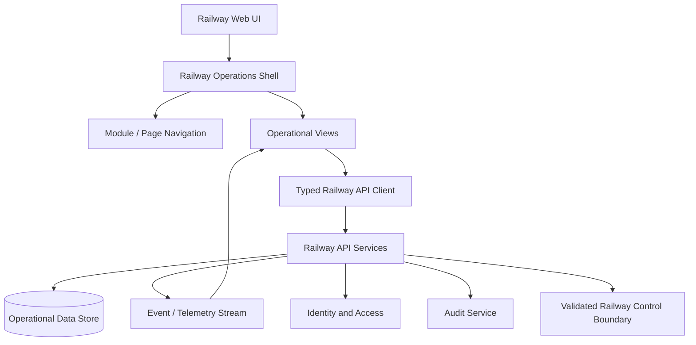
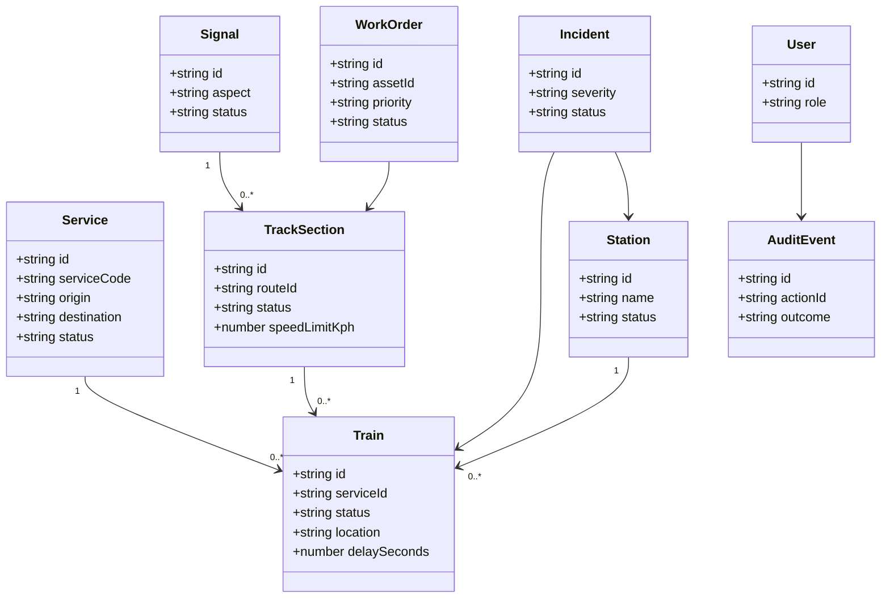
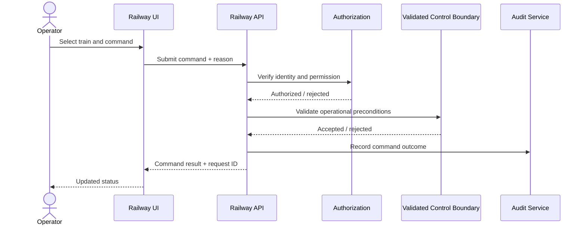

# Railway Operations Platform — Architecture & UML

## 1. System Architecture



## 2. Domain Model



## 3. Command Sequence



## 4. Module Architecture

```text
Railway Operations Shell
├── Control Center
├── Timetable & Service
├── Network Infrastructure
├── Train Fleet
├── Stations & Terminals
├── Signaling & Control
├── Asset Maintenance
├── Crew Operations
├── Safety & Emergency
├── Performance Intelligence
└── Administration & Security
```

## 5. Frontend Components

The railway workspace is composed from reusable shell, navigation, command, table, map, timeline, inspector, modal, status, and notification components. Module configuration is centralized in `src/railway/railwayModules.ts`.

## 6. Safety and Trust Boundaries

The web application is not the safety authority. The architecture deliberately places a validated control boundary between application commands and any real railway control equipment. The UI must fail closed when identity, authorization, data freshness, or control preconditions are unavailable.
